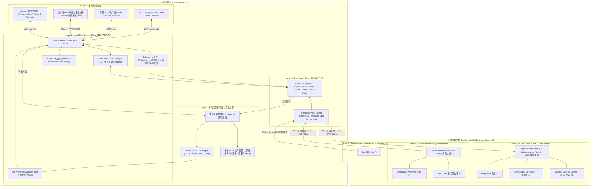
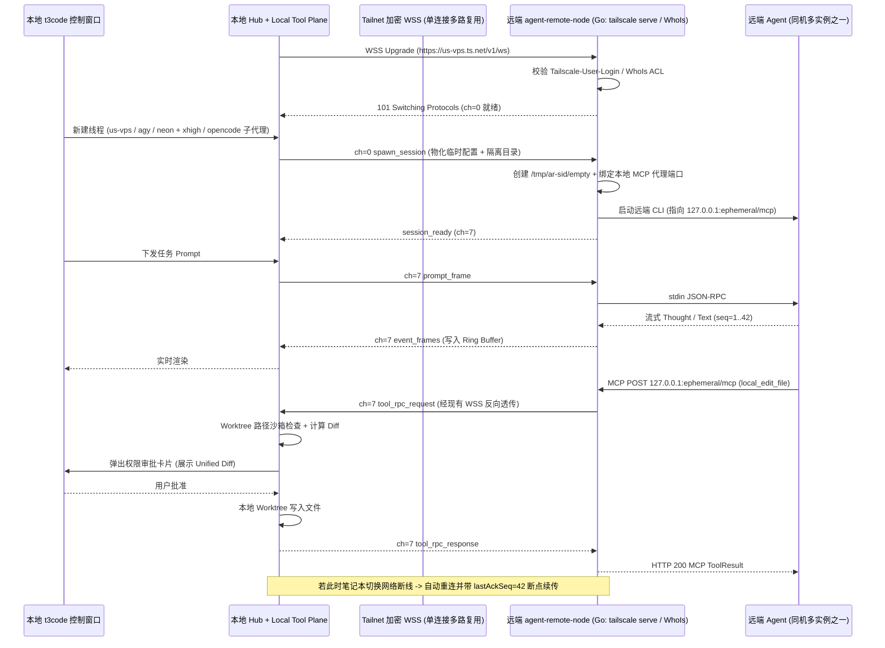
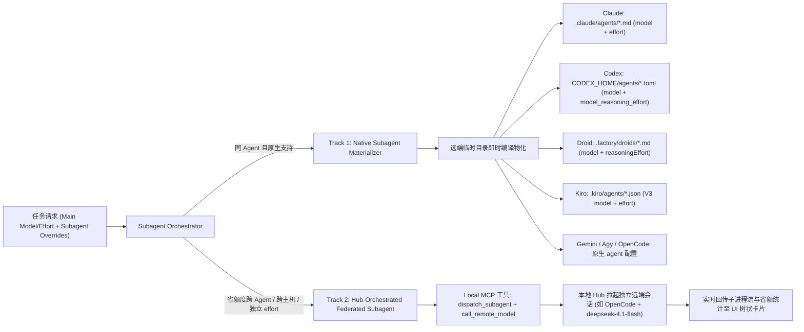

# `agent-remote` 分布式多 Agent 控制平面架构设计文档（v2.4 定稿版）

> [!NOTE]
> **架构定位**：融合 [AkaraChen/cc-remote](https://github.com/AkaraChen/cc-remote)（「远端跑模型与认证、本地跑代码与工具」）与 [pingdotgg/t3code](https://github.com/pingdotgg/t3code)（「本地单窗口多 Agent + Git Worktree 控制中心」）范式，构建支持 **7 大 Coding Agent**、**Tailscale Tailnet 直连多路复用**、**动态模型与参数同步**、以及**省额度跨 Agent 联邦子代理编排**的分布式开发控制平面。
> - **项目与 CLI 命名**：`agent-remote`（短别名 `ar`）
> - **代码仓库目录**：`/root/projects/agent-remote`

---

## 1. 设计目标与核心不变量

### 1.1 核心目标
1. **远端大脑 × 本地双手（Split-Plane Execution）**
   - **远端主机群（Remote Fleet）**：提供网络出口、订阅/OAuth 登录态、模型推理、System Prompt、内置联网搜索与 Subagent 调度。**登录凭据永不离开远端主机**。
   - **本地机器（Local Workstation）**：持有代码仓库、Git Worktree、Shell、编译/测试工具链及本地内网 MCP Server。**源码无需同步到远端**。
2. **多网络传输融合（Tailnet First + SSH Compatible）**
   - **Tailnet Direct（首选）**：通过 Tailscale Tailnet 直接建立加密会话，支持单连接多路复用、笔记本休眠/切网断点续传、零端口冲突的本地工具反向回调。
   - **Tailscale SSH / OpenSSH（零远端安装兜底）**：无需在远端部署常驻进程即可按需拉起会话。
3. **类似 `t3code` 的本地单窗口多 Agent 控制中心**
   - 一个本地窗口即可同时管理分布在同一台或不同远端主机上的 **7 大 Agent**（**Antigravity CLI、OpenCode、Claude Code、Codex CLI、Gemini CLI、Kiro CLI、Factory Droid**）。
   - 同时对外保留 **标准 ACP Agent（`agent-remote acp`）** 与 **CLI/TUI** 入口，所有前端共用同一个本地 Hub 引擎。
4. **任务级精细控制与省额度分流编排**
   - 动态读取每台远端主机上各个 Agent 当前账号实际可用的模型列表与参数能力并回传本地。
   - 集中定义与管理 Subagent 蓝图；下发不同任务时，可在输入框中**直接按任务覆盖主 Agent 及各个 Subagent 的模型与思考能力**（`off` → `max`），并支持将重 Token 子任务卸载给低成本开源/BYOK 节点（如 `opencode` + `deepseek-4.1-flash`），大幅节省闭源 CLI 额度。

### 1.2 核心不变量（Invariants）
- **远端零信任**：无论通过 Tailnet WSS 还是 SSH 回传，任何本地文件读写与命令执行必须 100% 通过本地 Policy Gate 与工作区/Worktree 路径沙箱校验。
- **Worktree 强隔离**：本地并发运行的多个远端 Agent 若操作同一 Git 仓库，各自锁定在独立 Git Worktree 沙箱目录内，物理杜绝并发覆盖冲突。
- **远端零污染**：远端会话始终在独立隔离目录（`/tmp/ar-<uid>-<sid>/`）物化临时配置与 Subagent 定义，绝不改写远端用户原有的 `~/.claude` / `~/.codex` / `~/.gemini` / `~/.kiro` / `~/.factory` / `opencode.json` 全局配置。

---

## 2. 总体架构：Local Hub Control Plane + Multi-Host Tailnet Fleet

借鉴 `t3code` 的 `Local Hub Server + Web/Desktop UI` 架构，本地运行一个轻量的 **Local Hub Server**，向上承接 Web/Electron 控制窗口、ACP IDE 客户端与 CLI/TUI，向下统一编排跨多台远端主机、每台主机多实例的 7 大 Agent。



---

## 3. 传输层架构：Tailscale Tailnet 直连与三模传输

为了同时满足「Tailnet 原生直连体验」与「部分受限主机零安装兼容」，传输层统一抽象为 **三种模式**，按主机配置自由混用：

### 3.1 Mode 1：Tailnet Direct 直连模式（推荐主力）

在远端主机部署极轻量的无状态转发节点 **`agent-remote-node`**（Go 单进程，只做进程托管、事件环形缓冲与 WSS 隧道复用，不存业务逻辑）。

1. **零公网暴露 + Tailscale 原生身份认证**
   - **接入方式 1A（`tailscale serve`，推荐）**：`agent-remote-node` 仅监听 `127.0.0.1:19420`，通过 `tailscale serve --bg https / http://127.0.0.1:19420` 暴露为 `https://<host>.<tailnet>.ts.net`。Tailscale 自动签发 TLS 证书、剥离伪造请求头，并在 WebSocket 握手阶段注入经密码学验证的 `Tailscale-User-Login` 与 `Tailscale-App-Capabilities` 头。
   - **接入方式 1B（嵌入式 `tsnet` 或 `tailscaled` LocalAPI `WhoIs`）**：节点直接以独立 Tailnet 设备身份接入（如 `agent-us-vps.tailnet.ts.net`），在 WebSocket Upgrade 阶段对 `RemoteAddr` 调用 `WhoIs()` 校验用户身份与 ACL Tag，无需 root 权限配置系统 `tailscale serve`。
   - **防绕过约束**：采用 `tailscale serve` 时，后端严格绑定 `127.0.0.1` 并开启双因子校验（Tailscale Identity + 节点 ACL 白名单），杜绝同机进程伪造 Header。

2. **单 WSS 连接多路复用 + MCP-over-WSS 零端口反向工具隧道**
   - 本地 Hub 与每台远端主机仅维持 **1 条长连接 WSS**，帧头携带 `channelId` 实现多路复用：
     - `ch=0`：节点心跳、Fleet 状态探测（CPU/内存/各 CLI 版本与登录态）、`catalog/discover` 动态模型目录探测、创建/销毁/挂载会话。
     - `ch=1..N`：同一主机上并发运行的 N 个 Agent 会话控制流（如同时跑 2 个 `agy`、1 个 `opencode`、1 个 `claude`）。
     - **反向工具通道（MCP-over-WSS，核心亮点）**：`agent-remote-node` 在远端回环 `127.0.0.1:<ephemeral>` 为每个会话起一个极薄的本地 HTTP MCP 入口（带随机 Bearer Token）；远端 CLI 调该 MCP 时，`agent-remote-node` 将 HTTP/MCP JSON-RPC 帧**沿已有的同一条 WSS 隧道逆向发回本地 Hub 的 Local Tool Plane**！
     - **优势**：本地笔记本**无需任何入站端口**、**无需在本地配 `tailscale serve`**、无视 NAT/公司防火墙/DERP 中继，彻底规避 SSH `AllowTcpForwarding` 限制。
   - *可选增强（Peer-to-Peer Direct MCP）*：若本地机器也开启了 Tailnet 监听且处于直连网段，可配置远端 CLI 直接访问本地 Tailnet IP 的加密 MCP Endpoint（本地校验 `WhoIs` + Per-Session Token），减少一次回环转发。

3. **断点续传与笔记本合盖保活（Session Roaming）**
   - `agent-remote-node` 为每个活跃会话维护有界内存事件环（Event Ring Buffer，默认保留最近 2000 条带递增 `seq` 的事件）。
   - 当本地笔记本休眠、切换 Wi-Fi/5G 或 Tailscale 切 DERP 引起 WebSocket Close (`1001`) 时，远端 Agent **不会被 SIGKILL 终止**（若正在等待本地工具返回，则挂起等待重连超时窗口，如默认 10 分钟）；本地 Hub 自动指数退避重连，携带 `sessionId + lastAckSeq` 瞬间补齐错过的流式事件并恢复工具审批！



### 3.2 Mode 2：Tailscale SSH（零远端安装模式）
- 适用于不想安装 `agent-remote-node` 的 Tailnet 主机：直接调用 `ssh <node>.<tailnet>.ts.net`（走 Tailscale SSH ACL 无密钥认证），利用 Strategy A / B（SSH `-R` 反向隧道或 Tailnet 直连本地 MCP 端点）完成工具拆分。

### 3.3 Mode 3：传统 OpenSSH（非 Tailscale 主机兼容模式）
- 复用 `~/.ssh/config`、`ProxyJump`、`ControlMaster` 连接复用、`ssh -O forward -R 127.0.0.1:0:...` 动态反向端口及 MOTD 哨兵过滤（`__AR_READY_<nonce>__`），确保传统 VPS 和企业跳板机照样纳入同一控制窗口管理。

| 能力维度 | Tailnet Direct (`agent-remote-node`) | Tailscale SSH | 传统 OpenSSH |
| :--- | :--- | :--- | :--- |
| **远端部署要求** | 需运行轻量 Go 单二进制 `agent-remote-node` | **零安装** | **零安装** |
| **单连接多路复用同机多 Agent** | **原生支持**（单 WSS 承载 N 会话） | 依赖 ControlMaster | 依赖 ControlMaster（Win 不支持） |
| **合盖休眠 / 切网会话保活与断点续传** | **原生支持**（Event Ring Buffer） | 不支持（断线即退出） | 不支持 |
| **穿透禁止 TCP 转发的 SSH 服务器** | **完全无影响**（MCP-over-WSS） | 受限（可切 Tailnet 直连 MCP） | 受限（仅 Strategy A 可用） |
| **身份鉴权** | Tailscale WhoIs / ACL（免 Key） | Tailscale ACL（免 Key） | SSH Key / Agent |

---

## 4. 本地 `t3code` 风格多 Agent 控制窗口设计

参考 `pingdotgg/t3code` 的设计哲学：**本地 Hub Server 居中协调一切，前端为轻量高响应的 React/Vite Web 应用（Phase 1 浏览器直开），Phase 3 封装为 Electron 桌面窗口，同时保留手机/平板经 Tailscale 远程查看与审批的能力**。

### 4.1 窗口三栏工作台布局（Single Window Multi-Agent Workbench）

```text
┌───────────────────────────┬───────────────────────────────────────────────┬────────────────────────────┐
│  [+ New Thread] [Fleet ●] │  Tab1: Agy@us-vps [feat/auth]  Tab2: OpenCode │  [Diff (4)] [Term] [Agents]│
├───────────────────────────┤───────────────────────────────────────────────┼────────────────────────────┤
│ PROJECTS / WORKTREES      │  ┌─ Host: us-vps.ts.net (Tailnet Direct 28ms) │  CHANGED FILES (Worktree)  │
│ ▾ agent-remote            │  │  Agent: Antigravity | Model: gemini-4-neon │  M src/transport/ws.ts +84 │
│   ● 修复鉴权 (Agy/us)     │  │  Effort: xhigh | Quota-Saver: ON (省 68%)  │  A src/subagent/map.ts +62 │
│     └ wt: feat/auth       │  └────────────────────────────────────────────│  M package.json         +3 │
│   ◐ 写单测 (OpenCode/us)  │                                               │                            │
│     └ wt: test/ws         │  [Thought ▾ 12s] 分析 Tailscale WhoIs 握手... │  ── Unified Diff View ──   │
│   ⚠ 审阅API (Kiro/corp)   │                                               │  @@ -41,6 +41,14 @@        │
│     └ 等待审批 (1)        │  ┌─ Subagent: explorer (Federated / Offload)  │  + verifyTailscaleUser()   │
│   ✓ 调研 (Claude/us)      │  │  [OpenCode@us-vps | deepseek-4.1-flash]    │                            │
│                           │  │  ✓ grep("WhoIs") -> 精炼摘要 380 tokens    │  [Commit] [Push] [Open PR] │
│ ▾ another-repo            │  └────────────────────────────────────────────│                            │
│   ● 重构 (Agy/jp)         │                                               │  ── Local Terminal ──      │
│                           │  ┌─ 权限审批: Edit src/transport/ws.ts ───────│  $ pnpm test               │
│ REMOTE FLEET              │  │  [Allow Once] [Allow Session] [Deny...]    │  ✓ 24 passed (1.4s)        │
│ ● us-vps.ts.net   (3/6)   │  └────────────────────────────────────────────│                            │
│ ● jp-dev.ts.net   (2/4)   ├───────────────────────────────────────────────┤                            │
│ ● corp-bastion    (1/2)   │  [输入框: 输入下一条任务指令...]              │                            │
│                           │  [Host: us-vps ▾] [Agent: Agy ▾]              │                            │
│ SUBAGENT PRESETS          │  [Model: gemini-4-neon ▾] [Effort: xhigh ▾]   │                            │
│ ⚙ architect (pro/xhigh)   │  [Subagents: explorer(deepseek/low), +1 ⚙]    │                            │
│ ⚙ explorer  (deepseek/low)│  [Worktree: feat/auth ▾] [Quota-Saver ✓][Send]│                            │
└───────────────────────────┴───────────────────────────────────────────────┴────────────────────────────┘
```

### 4.2 核心交互亮点（对标并超越 `t3code`）
1. **单窗口多主机多 Agent 并发 + 分屏对比**：
   - 左侧按本地项目分组管理全部 Thread；支持将任意两个 Thread 并排分屏对照方案与 Diff。
   - 待审批徽章（`⚠ 等待审批`）全局置顶提醒，支持全局快捷键快速切换审批队列。
2. **Git Worktree 深度集成（原生防冲突）**：
   - 创建 Thread 时一键选择「在当前工作区运行」或「创建独立 Worktree（自动切出分支）」。
   - 右侧 Diff 面板实时基于本地 `git diff` 呈现改动，支持逐 hunk 检视、单文件回滚、Commit、Push 及一键创建 PR / Merge 回主分支。
3. **任务级动态配置栏（Per-Task Composer）**：
   - 发送**每一条任务**前，可直接在输入框底栏修改：目标 Host、目标 Agent、主模型（来自远端实时拉回的目录）、主思考深度（Thinking Effort）、一键开关 `Quota-Saver`，以及点开 **Subagent 配置弹窗**临时勾选/覆写本次任务各个 Subagent 的目标 Agent、模型与思考深度。
4. **双入口完全同源**：
   - 外部 IDE（Zed / JetBrains）通过 `agent-remote acp`（或 `ar acp`）接入，或终端用户通过 `ar chat` / `ar exec` 运行时，全部连接到同一套 **Local Hub Core**，共享同一份 Host Fleet、动态模型目录、Subagent 预设、权限策略与会话历史。

---

## 5. 动态模型目录发现、Subagent 配置与任务级参数编排引擎

这是本架构区别于普通远程代理的核心差异化能力。系统不仅支持**实时动态读取每台远端主机上各个 Agent 当前账号实际可用的模型列表及参数能力并回传本地**，还支持在本地窗口集中配置 Subagent，并按任务动态指定主 Agent 与各 Subagent 的模型、思考深度及其他模型参数。

### 5.1 动态模型目录发现与参数回传同步（Model Catalog & Parameter Sync）

由于不同远端主机、不同订阅层级、不同云网关（Anthropic API / Bedrock / Vertex / BYOK 自定义网关）看到的模型列表和支持的思考档位完全不同，**本架构严禁在本地写死静态模型列表**，而是按 **`(hostId, profileId)`** 维度建立实时动态发现与回传链路：

#### A. 7 大后端动态模型与能力读取方式

| 后端 Agent | 实时模型目录发现方式 | 能读取到的元数据与参数能力 | 运行期本地参数下发方式 |
| :--- | :--- | :--- | :--- |
| **1. Antigravity CLI** (`agy`) | ① `agy models` CLI 探测（返回当前账号含第三方接入的全部模型 slug）+ `/effort` 探测<br>② `agy acp` 的 `session/new` `configOptions` | 账号专属可用模型列表与对应支持的 `effort` 档位（`low` ~ `max`） | 会话内：ACP `session/set_config_option` / `/effort`；启动/子代理：`--model`、`--effort`、SDK `LocalAgentConfig` |
| **2. OpenCode** (`opencode`) | ① `opencode acp` 会话初始化返回的 `configOptions` / `opencode models`<br>② 读取远端 `opencode.json` 已配置的自定义 provider/model | 全部已配置 provider 的模型列表（如 `deepseek/deepseek-4.1-flash`、OpenRouter、Ollama、Anthropic 等） | 会话内：ACP `session/set_config_option`；启动/子代理：`OPENCODE_CONFIG_CONTENT` 零污染注入 `model` 与工具权限 |
| **3. Claude Code** (`claude`) | ① Claude Agent SDK 控制通道初始化响应 / `supportedModels()`<br>② ACP `session/new` 返回的 `configOptions`（`category: "model"` / `effort`） | 账号实际可用模型与别名（如 `opus` / `sonnet` / `haiku` / `opus[1m]` 等）及各模型支持的 `effort` 档位 | 会话内：SDK `setModel` / ACP `session/set_config_option` / `/effort`；启动/子代理：`--model`、`--effort`、frontmatter |
| **4. Codex CLI** (`codex`) | **`codex app-server` 原生 `model/list` JSON-RPC**（支持 `includeHidden` 与自定义 `model_catalog_json` / provider） | 结构最完整：直接返回每个模型的 `model`、`name`、`inputModalities`、`defaultReasoningEffort`、**`supportedReasoningEfforts` 数组** | 会话内：`thread/start` / `thread/settings/update` 及 turn 级 `reasoning_effort`；启动/子代理：`-m`、`-c model_reasoning_effort=...`、`agents/*.toml` |
| **5. Gemini CLI** (`gemini`) | `gemini --acp` 在 `session/new` 返回的 ACP **`configOptions`**（`configId: "model"` 等 `select` 选项） | 当前账号/认证方式下真实可用的实时模型选项列表与思考/模式配置项 | 会话内：ACP `session/set_config_option` 热切换；启动/子代理：`-m`、thinking 配置、`.gemini/agents/*.md` |
| **6. Kiro CLI** (`kiro-cli`) | ① `kiro-cli chat --list-models` 快速探测<br>② `kiro-cli acp` 返回的 `configOptions`（`model` + `effort` 动态选项） | 可用模型 ID（Claude / GPT / 开源模型等）、信用倍率及该模型支持的 `effort` 档位 | 会话内：ACP `session/set_config_option` / `/effort`；启动/子代理：`--model`、`--effort`、V3 Profile JSON |
| **7. Factory Droid** (`droid`) | ① Droid SDK `listModels()` / `droid exec --output-format acp` 能力回报<br>② 读取远端 `~/.factory/settings.json` 中的 **`customModels`（BYOK 数组）** 合并 | Factory 托管模型 + 远端自定义 BYOK 模型（含 `displayName`、`provider`、`maxOutputTokens`）与 `reasoningEffort` 支持 | 启动/子代理：`-m`、`--reasoning-effort`、`.factory/droids/*.md`（含 `custom:<id>`） |

#### B. 统一模型目录数据模型（传回本地驱动 UI 与 ACP）

远端探测完成后，通过 Tailnet WSS 控制通道（`ch=0` `catalog/discover`）或 SSH `Driver.discoverModels()` 统一归一化为 `ModelCatalogEntry` 回传至本地 Hub 并持久化缓存到 SQLite：

```ts
export interface ModelParamOption {
  value: string;
  label: string;
  description?: string;
}

export interface ModelParamSchema {
  id: string;                // 如 "effort" | "thinking_budget" | "fast_mode" | "context_window"
  category: "thought_level" | "mode" | "custom";
  label: string;
  type: "select" | "boolean" | "number";
  options?: ModelParamOption[];
  defaultValue?: string | boolean | number;
}

export interface ModelCatalogEntry {
  id: string;                // 远端真实模型 ID（原样回传给远端执行）
  displayName: string;
  source: "live-rpc" | "cli-probe" | "custom-byok" | "fallback";
  isDefault?: boolean;
  aliases?: string[];
  inputModalities?: ("text" | "image" | "audio" | "pdf")[];
  contextWindow?: number;
  capabilities: {
    supportsThinking: boolean;
    supportedEfforts: ThinkingEffort[]; // 该模型精确支持的思考档位
    defaultEffort?: ThinkingEffort;
    extraParams?: ModelParamSchema[];   // 从 ACP configOptions 等动态透传的扩展参数
  };
}
```

#### C. 本地消费与回传生效闭环
1. **自动刷新与缓存策略**：
   - 本地 Hub 连接远端主机（或用户执行 `ar doctor` / 点击 UI「刷新模型列表」）时自动拉取并按 `(hostId, profileId)` 缓存（默认 TTL 15 分钟）；每次建立新会话若远端 `configOptions` 出现新增/变更模型，自动增量回写本地缓存并实时推送给前端。
   - **手动 Override 逃生舱**：UI 模型选择器既支持从动态拉回的列表中下拉点选，也允许手动输入任意模型 ID（应对灰度新模型或自定义网关别名）。
2. **驱动双前端动态渲染**：
   - **`t3code` 控制窗口**：用户切换目标 `Host` / `Agent` 后，输入框下方的 **Model 下拉框**、**Thinking Effort 档位条**、**扩展参数（来自 `extraParams`）** 以及 **Subagent 配置弹窗**立刻按该远端账号真实目录联动渲染。
   - **本地 ACP Server（`ar acp`）**：将同一份动态目录直接转化为标准 ACP `configOptions` 暴露给 Zed / JetBrains，使外部 IDE 也能无缝切换远端模型与思考强度。
3. **参数下发回远端（双生效路径）**：
   - **热切换（Hot Switch）**：活跃会话内优先调用协议原生更新（ACP `session/set_config_option`、Codex `thread/settings/update`、Claude SDK `setModel`），秒级生效不丢上下文。
   - **启动/子代理编译注入（Launch & Materialize）**：新开线程、或任务覆写子代理模型参数时，直接编译写入远端启动参数与隔离临时配置文件（对于静态读取配置的 Subagent，自动触发无感 `--resume` 热重载）。

### 5.2 统一思考能力标准档位（Canonical Effort Levels）

不同 Agent 与模型家族对思考深度的命名不尽相同。内核定义统一的 7 级枚举 `ThinkingEffort`：
`off | minimal | low | medium | high | xhigh | max`

各 Driver 结合 5.1 动态拉回的 `supportedEfforts` 进行映射：在 UI 中只高亮当前所选模型真实支持的档位；若任务预设要求某档位（如 `xhigh`）而目标模型仅支持到 `high`，UI 显式提示并映射至最接近档位（**绝不静默丢弃**）。

### 5.3 统一 Subagent 蓝图与任务级覆盖（Task-Scoped Override）

本地维护一份平台无关的 **Subagent Blueprint**（可在 UI 表单可视化编辑，底层存 SQLite / TOML）：

```toml
# 示例：省额度 Subagent 蓝图
[subagents.architect]
description = "深度架构设计与复杂根因排查"
system_prompt = "专注系统边界、并发安全与性能瓶颈，输出可执行方案。"
tools = ["read_file", "grep", "glob", "list_dir"]
execution_mode = "auto" # auto | native | federated
default_model = "inherit"
default_effort = "high"

[subagents.explorer]
description = "快速代码库检索与上下文摘要（默认卸载给低成本模型省主脑额度）"
system_prompt = "高效定位关键文件与符号，输出精简调用链摘要，控制返回长度。"
tools = ["read_file", "grep", "glob", "list_dir"]
execution_mode = "federated"
default_profile = "us-opencode"
default_model = "deepseek/deepseek-4.1-flash"
default_effort = "low"

[subagents.implementer]
description = "按主脑给定方案编写样板代码与单元测试"
tools = ["read_file", "edit_file", "write_file", "run_command", "grep", "glob"]
execution_mode = "auto"
default_profile = "us-opencode"
default_model = "deepseek/deepseek-4.1-flash"
default_effort = "medium"
```

下发任意任务时，请求体可携带 **Task Override**：
```json
{
  "target": { "host": "us-vps", "profile": "us-agy" },
  "main": { "model": "gemini-4-neon", "effort": "xhigh" },
  "quota_saver_mode": true,
  "subagents": {
    "explorer":    { "enabled": true, "execution_mode": "federated", "host": "us-vps", "profile": "us-opencode", "model": "deepseek/deepseek-4.1-flash", "effort": "low" },
    "implementer": { "enabled": true, "execution_mode": "federated", "host": "us-vps", "profile": "us-opencode", "model": "deepseek/deepseek-4.1-flash", "effort": "medium" },
    "architect":   { "enabled": true, "execution_mode": "federated", "host": "us-vps", "profile": "us-agy",      "model": "gemini-4-neon",               "effort": "max" }
  }
}
```

### 5.4 双轨 Subagent 执行架构与省额度分流机制

不同 CLI 对原生 Subagent 配置的支持存在客观差异（尤其是 Claude 静态读取 frontmatter、Gemini/Antigravity CLI 原生 frontmatter 不支持独立 `effort`）。因此，**Subagent & Effort Orchestrator** 设计为**双轨执行引擎**：



#### Track 1：Native Subagent Materializer（原生即时物化编译）
- **工作原理**：会话启动（或任务覆写变更）时，Driver 将统一蓝图 + 任务覆写参数即时编译为目标 Agent 的原生配置文件，写入远端会话隔离目录 `/tmp/ar-<sid>/`：
  - **Claude Code**：编译为 `.claude/agents/<name>.md`（写入 `model`、`effort`、`tools`/`disallowedTools`）。同一线程中途修改 Subagent 参数时，自动执行 **Seamless Hot-Reload**（保留 `remoteSessionId` 无感 `--resume` 重启）。
  - **Codex CLI**：在 `/tmp/ar-<sid>/codex-home/` 软链远端 `auth.json`，生成覆写后的 `config.toml` 与 `agents/<name>.toml`。
  - **Factory Droid**：编译为 `.factory/droids/<name>.md`（写入 `model` + `reasoningEffort`；若覆写了 `reasoningEffort` 则自动展开 `inherit` 为具体模型 ID）。
  - **Kiro CLI**：编译为 V3 Agent Profile JSON（`.kiro/agents/<name>.json`），显式写入 `model`、`effort` 与 MCP 白名单。
  - **Gemini CLI / Antigravity CLI**：编译为 `.gemini/agents/*.md` / `.agents/agents/*.md`（写入模型档位及工具白名单）。若任务要求为子 Agent 设置独立 `effort` 或跨厂商模型，`execution_mode = "auto"` 自动升级到 Track 2。

#### Track 2：Hub-Orchestrated Federated Subagent & Quota-Saver Offloading（中枢联邦子代理与省额度分流）
- **工作原理**：本地 Hub 在 Local Tool Plane 中自动注册两个跨 Agent 协同工具：
  1. **`dispatch_subagent(target_profile, task, model?, effort?, context_files?)`（完整 Agent 子任务委派）**：当远端主 Agent（如 `agy`）触发该工具时，本地 Hub 按目标配置向同一台或另一台远端主机拉起独立的子会话（例如 `opencode` 指定 `deepseek/deepseek-4.1-flash`，或 `codex` 指定 `gpt-5.5` + `high`），子 Agent 同样经由本地 Tool Plane 操作当前 Worktree（只读子任务自动收紧为只读沙箱），执行完毕将精炼结果与 Diff 汇总交回主 Agent。
  2. **`call_remote_model(target_profile, prompt, model?, effort?)`（纯推理轻量调用，无工具）**：如果主 Agent（如 `agy`）只是想借用另一个 Agent 里的低成本模型（如 `opencode` 里的 `deepseek-4.1-flash`）做纯文本摘要、批量分析、长日志压缩或草稿生成，而不让其操作本地文件，Hub 以无工具单轮模式直接向目标远端 Agent 发起推理并返回精炼结果，延迟更低、开销更小。
- **省额度分流模式（Quota-Saver Offloading）**：
  - 针对「**保住闭源 CLI 宝贵额度，把重 Token 脏活累活卸载给低成本模型**」的核心场景，支持在任务栏一键开启 `quota_saver_mode`：
    1. **自动卸载引导**：Hub 自动向主 Agent 注入轻量委派指引——凡大范围代码库探索（`explorer`）、样板代码/单测编写（`implementer`）、长构建日志压缩（`call_remote_model`），优先委派给已绑定的低成本子代理池（如 `opencode` + `deepseek-4.1-flash`），只把精炼结论或验证通过的 Diff 摘要带回主脑上下文，大幅削减闭源主模型的上下文膨胀与额度消耗。
    2. **额度节省可观测**：UI 线程面板与 Inspector 实时区分统计「**闭源主脑消耗 Token**」与「**已卸载至子代理池 Token**」，省额效果一目了然。
- **平台边界说明（不硬改闭源主循环）**：`agy`、`claude`、`kiro` 等闭源托管 CLI 的主推理循环绑定自家账号鉴权目录，不支持把 `opencode` 内部模型直接替换成 `agy` CLI 自身的主脑。通过 **Track 2 联邦子代理 + `call_remote_model`** 实现跨 Agent 分流，是零破解、不违反订阅认证且覆盖全部 7 大后端的最优工程方案。

---

## 6. 工具拆分策略与七大后端 Agent 适配矩阵

工具回传采用 **三策略混合模型**，并与 Tailnet Direct 深度结合（Tailnet Direct 模式下 Strategy B 无需 SSH `-R` 端口，直接走 **MCP-over-WSS**）：

| 后端 Agent | 远端协议通道 | 工具拆分策略 | 禁用/拦截远端内置工具 | 原生 Subagent + 思考深度适配 |
| :--- | :--- | :--- | :--- | :--- |
| **1. Antigravity CLI** (`agy` / SDK) | `agy acp` / `stream-json`（或远端 `google-antigravity` SDK） | **Strategy B + C1**（Phase 1 首发） | CLI：`permissions.deny` + `pretooluse` Hook + `session/new` `mcpServers`；SDK：`CapabilitiesConfig(disabled_tools=...)` | 主：`--model` + `--effort`；子：档位走 Track 1，独立 `effort` / 跨模型自动走 Track 2 联邦子代理 |
| **2. OpenCode** (`opencode`) | `opencode acp`（原生 ACP JSON-RPC stdio） | **Strategy B + C1**（Phase 1 首发） | 环境变量 `OPENCODE_CONFIG_CONTENT` 注入会话级 JSON：`permission: { "*": "deny", "local_tools_*": "allow" }` + `tools: { bash: false, edit: false, write: false }` + 挂载本地 MCP | 主：`OPENCODE_CONFIG_CONTENT` 指定任意 `provider/model`（如 `deepseek/deepseek-4.1-flash`）；极适合做 BYOK/开源模型池与跨 Agent 省额度子代理执行节点 |
| **3. Claude Code** (`claude`) | CLI `stream-json` / SDK 控制通道 | **Strategy A**（内联 SDK 通道） | `--disallowedTools Read,Write,Edit,MultiEdit,Bash,Glob,Grep,LS,NotebookEdit` | 主：`--model` + `--effort`；子：Track 1 物化 `.claude/agents/*.md` + 改配时无感 `--resume` 热重载 |
| **4. Factory Droid** (`droid`) | `droid --stream-jsonrpc` / `exec --output-format stream-json` | **Strategy B**（MCP-over-WSS / `-R`） | `--remove-tools Execute,Read,Edit,Create,ApplyPatch,Grep,Glob,LS` + `--add-tools MCP:local_tools` | 主：`-m` + `--reasoning-effort`；子：Track 1 物化 `.factory/droids/*.md`（自动展开 `inherit` 保 `reasoningEffort` 生效） |
| **5. Kiro CLI** (`kiro-cli`) | `kiro-cli acp --agent <ephemeral>` | **Strategy B + C1**（MCP + ACP 能力回调） | 临时 V3 Profile：`tools` 白名单仅含 `@local_tools/*` + `permissions.rules` `deny` 内置 `shell`/`fs_*` | 主：`--model` + `--effort`；子：Track 1 物化 V3 `.kiro/agents/*.json`（原生支持 `model` + `effort`） |
| **6. Gemini CLI** (`gemini`) | `gemini --acp` | **Strategy B + C1** | 临时 Policy Engine TOML（全局 `decision = "deny"` 彻底移出上下文）+ 临时 `mcpServers` | 主：`-m` + thinking 配置；子：仅改模型走 Track 1，需独立 `effort` 时自动升级 Track 2 联邦子代理 |
| **7. Codex CLI** (`codex`) | `codex app-server`（JSON-RPC stdio） | **Strategy A' + C2**（`dynamicTools` + 审批拦截） | 远端空目录 + `--sandbox read-only` + `developer_instructions` + JSON-RPC 审批层 Reject 纠偏（备选 Reverse MCP） | 主：`-m` + `model_reasoning_effort`；子：隔离 `CODEX_HOME` 编译 `config.toml` + `agents/*.toml` 精准控模型与思考深度 |

---

## 7. 多主机 & 同主机多 Agent 拓扑数据模型与配置示例

为了清晰表达「**不同主机**」与「**同一主机上多个 Agent（甚至同一 Agent 多账号/多配置）**」，数据模型将 **Host（机器）**、**AgentProfile（机器上的 Agent 实例）**、**SubagentPreset（子代理蓝图）**、**Thread（对话线程）** 彻底解耦：

```text
HostNode (1) ──────< (N) AgentProfile (1) ──────< (N) Thread ──────> (1) Local Workspace / Git Worktree
                                                       │
                                                       └──< (N) TaskOverride (Main Model/Effort + Subagents)
```

### 配置示例（`~/.config/agent-remote/config.toml`）

```toml
[hub]
bind = "127.0.0.1:3775"
expose_over_tailscale = false # 设为 true 时可通过手机/平板 Tailnet 访问本地审批界面
default_profile = "us-agy"

# ========= 1. 远端主机池（不同主机，支持混合传输模式）=========
[hosts.us-vps]
transport = "tailnet-direct"
endpoint = "wss://us-vps.tailnet-abc.ts.net/v1/ws"
auth = "tailscale-serve" # 自动校验 Tailscale-User-Login
max_concurrent_sessions = 8

[hosts.jp-dev]
transport = "tailnet-direct"
endpoint = "wss://jp-dev.tailnet-abc.ts.net/v1/ws"
auth = "tsnet-whois"
max_concurrent_sessions = 6

[hosts.corp-box]
transport = "tailscale-ssh" # 零安装兜底
ssh_target = "dev@corp-box.tailnet-abc.ts.net"
reverse_mcp_mode = "tailnet-direct-or-ssh-r"

# ========= 2. 同主机多 Agent 实例（us-vps 同机挂 agy + opencode + 其他）=========
[profiles.us-agy]
host = "us-vps"
agent = "antigravity"
antigravity_mode = "auto" # auto | cli | python-sdk
remote_bin = "agy"
default_effort = "high"

[profiles.us-opencode]
host = "us-vps"
agent = "opencode"
remote_bin = "opencode"
default_model = "deepseek/deepseek-4.1-flash"

[profiles.us-claude]
host = "us-vps"
agent = "claude"
remote_bin = "claude"
default_effort = "high"

[profiles.us-codex]
host = "us-vps"
agent = "codex"
remote_bin = "codex"
default_effort = "high"

# ========= 3. 其他主机上的 Agent =========
[profiles.jp-agy]
host = "jp-dev"
agent = "antigravity"
remote_bin = "agy"
default_effort = "high"

[profiles.corp-kiro]
host = "corp-box"
agent = "kiro"
remote_bin = "kiro-cli"
default_effort = "medium"

# ========= 4. 任务级快捷场景模板（一键切换省额度组合）=========
[task_presets.agy-quota-saver]
main_profile = "us-agy"
main_effort = "xhigh"
quota_saver_mode = true
[task_presets.agy-quota-saver.subagents]
explorer    = { profile = "us-opencode", model = "deepseek/deepseek-4.1-flash", effort = "low",    mode = "federated" }
implementer = { profile = "us-opencode", model = "deepseek/deepseek-4.1-flash", effort = "medium", mode = "federated" }
architect   = { profile = "us-agy",      effort = "max",                        mode = "federated" }
```

---

## 8. 安全边界、本地工具执行面与并发 Worktree 隔离

> [!CAUTION]
> 当同一窗口中并发跑着多个来自不同远端主机的 Agent 时，安全边界不仅是“防远端越权”，还要“防并发互相踩踏”。

1. **Per-Thread Worktree 路径沙箱**
   - 每个 `Thread` 在 Local Tool Plane 拥有独立的 `ToolSandboxContext`，其根目录严格绑定到该线程所属的 `worktreePath`（若用户未启用 Worktree，则对主目录加文件级乐观锁 + 并发写警告）。
   - 所有文件操作展开 `realpath` 后强制校验位于 `worktreePath` 内；禁止触碰 `.git/` 敏感钩子及工作区外路径（除非用户显式为该线程授权 `--add-dir`）。
2. **统一本地工具集 + 本地 MCP 联邦**
   - 核心工具：`read_file`、`edit_file`（mtime/hash 校验 + 自动生成 Unified Diff）、`write_file`、`delete_file`、`list_dir`、`glob`、`grep`（优先本地 `rg`）、`run_command`（流式输出、超时、进程组 PGID kill）。
   - 本地配置的第三方 MCP Server（本地数据库、内网 GitLab、Playwright 等）由 Local Hub 统一托管并按 Profile 权限规则按需暴露给指定远端 Agent。
3. **四级权限防线**
   - Tailscale WhoIs/ACL（或 SSH 密钥） → Per-Session 256-bit Bearer Token → Worktree 路径沙箱 + 声明式 Policy Engine（`deny > ask > allow`） → UI/ACP/TUI 交互式人工审批弹窗（含完整 Diff 与命令预览）。

---

## 9. 已锁定技术栈与混合语言 Monorepo 目录规划

### 9.1 已锁定技术栈（Go + TypeScript 混合架构）
- **本地控制平面与 UI：TypeScript Monorepo (`pnpm workspace` + Node 22+)**
  - **Local Hub Server (`apps/hub-server`)**：Fastify / `ws` + SQLite + 官方 `@agentclientprotocol/sdk`、`@modelcontextprotocol/sdk`、`@anthropic-ai/claude-agent-sdk`。
  - **Web UI (`apps/web`)**：React 19 + Vite + TailwindCSS + Shiki/Diff Viewer（Phase 1 优先落地浏览器控制窗口，快速打磨多主机/多 Agent 交互）。
  - **Desktop Shell (`apps/desktop`)**：**Electron**（Phase 3 封装，与 `t3code` 同架构，内嵌拉起本地 Hub Server）。
  - **CLI / TUI (`apps/cli`)**：`Ink` TUI + `ui` / `acp` / `chat` / `exec` / `doctor` / `node` 子命令（主命令 `agent-remote`，短别名 `ar`）。
- **远端轻量节点 (`apps/remote-node`)：Go 单二进制（`go 1.24+`）**
  - 原生集成 `tailscale.com/tsnet` 与 `tailscale serve`（`LocalClient.WhoIs()`）双接入模式。
  - 编译为单文件零依赖二进制（`linux/amd64`、`linux/arm64`、`darwin/arm64`），支持 `ar node install <host>` 一键部署，负责多路复用 WSS、会话事件环（Ring Buffer）断点续传、MCP-over-WSS 反向工具隧道与临时隔离目录自清理。

### 9.2 目录结构

```text
/root/projects/agent-remote/
├── apps/
│   ├── remote-node/          # [Go] 远端轻节点：tsnet / tailscale serve + WSS 多路复用 + MCP-over-WSS + Event Ring
│   ├── hub-server/           # [TS] 本地控制中枢：WS/HTTP API、SQLite、Worktree 管理、Fleet 路由、模型目录缓存
│   ├── web/                  # [TS] t3code 风格多 Agent Web 控制窗口（React + Vite + Diff/Subagent 树视图）
│   ├── desktop/              # [TS] Electron 桌面应用外壳（Phase 3），内嵌拉起 hub-server
│   └── cli/                  # [TS] CLI 入口（agent-remote / ar）：ui / acp / chat / exec / doctor / node
├── packages/
│   ├── protocol/             # Hub↔UI、Hub↔RemoteNode 共享协议规范（JSON Schema / Zod + Go struct 对齐）
│   ├── core/                 # Canonical Event、ModelCatalog、Effort 映射、Session/Config 模型
│   ├── subagent-orchestrator/# 统一 Subagent 蓝图、原生编译器（Track 1）+ 跨主机省额度联邦调度（Track 2）
│   ├── tool-plane/           # 本地核心工具集、Worktree 沙箱、Policy 权限网关、本地 MCP 联邦代理
│   ├── transport/            # 三模传输层（tailnet-direct / tailscale-ssh / openssh）
│   ├── acp-server/           # 标准 ACP v1 JSON-RPC Server（接入 Zed / JetBrains，同步透传动态 configOptions）
│   └── drivers/
│       ├── antigravity/      # [Phase 1 首发] agy acp / stream-json + 可选 Python SDK 适配
│       ├── opencode/         # [Phase 1 首发] opencode acp + OPENCODE_CONFIG_CONTENT（低成本子代理池 / DeepSeek 等 BYOK）
│       ├── claude/           # [Phase 2] Claude Code SDK / stream-json 适配
│       ├── codex/            # [Phase 2] Codex app-server (model/list + dynamicTools + 审批拦截)
│       ├── gemini/           # [Phase 2] Gemini CLI (--acp + Policy Engine)
│       ├── kiro/             # [Phase 2] Kiro CLI (kiro-cli acp + V3 Profile)
│       └── factory-droid/    # [Phase 2] Factory Droid (--remove-tools + BYOK customModels)
└── docs/
    └── architecture.md
```

---

## 10. 分阶段实施路线图（AGY-First 定稿版）

> [!IMPORTANT]
> 结合当前远端主机**短期仅就绪 `agy`（Antigravity CLI）** 的真实环境，路线图优先以 **`agy` + `opencode`（低成本子代理池）+ Go `remote-node`（Tailnet Direct）+ 本地 Web 控制窗口 + Track 2 省额度联邦子代理** 作为 Phase 1 首发闭环，确保第一阶段就能在真实生产中立刻用起来；同时保持 `AgentDriver` 接口与协议完全通用，后续远端安装任意新 CLI 即可即插即用。

- **Phase 0：AGY 协议深度验证 + 工程骨架初始化（1~2 天）**
  1. 在 `/root/projects/agent-remote` 初始化 **Go + pnpm TypeScript 混合 Monorepo** 及共享协议包 `packages/protocol`。
  2. 实机验证远端 `agy` 关键能力边界：
     - `agy models` 输出格式与 `agy acp` `session/new` 返回的 `configOptions`（模型列表 + `effort` 选项）；
     - `agy acp` 通过 `session/new` 的 `mcpServers` 挂载本地 MCP、通过 `permissions.deny` / `pretooluse` 阻断远端内置工具的实际效果（以及是否需要提供 `google-antigravity` Python SDK 增强模式）；
     - 同一台远端主机并发拉起多个 `agy` 会话时的隔离目录与并发稳定性。
- **Phase 1：Tailnet Direct + AGY/OpenCode 双首发 MVP + Web 控制窗口（1.5~2 周）**
  1. **Go `apps/remote-node`**：实现 `tailscale serve` / `tsnet` WhoIs 鉴权、单 WSS 多路复用、`ch=0` 节点探测与 `catalog/discover`、MCP-over-WSS 反向工具隧道、Event Ring 断线重连续传。
  2. **Local Hub + Tool Plane**：实现统一本地工具引擎（FS / Search / `rg` / Shell PGID kill）、Git Worktree 隔离沙箱、Zero-Trust Policy Gate、SQLite 状态库、动态模型目录缓存，以及 SSH / Tailscale SSH 兜底传输。
  3. **首发双 Driver（`Antigravity` + `OpenCode`）+ Track 2 省额度联邦子代理**：
     - 完整支持从远端 `agy` 与 `opencode` 动态拉取模型清单与 `effort` 档位回传本地；
     - 支持同一主机并发多开多个会话，并率先打通 **Track 2 省额度联邦子代理（`quota_saver_mode`）**：既能让单台 `agy` 主机为每个 Subagent 独立指定不同模型与 `effort`，也能直接用 `agy` 主脑把检索/单测/日志压缩等重 Token 子任务卸载给 `opencode`（如 `deepseek-4.1-flash`），大幅节省闭源额度！
  4. **Web 版 `t3code` 控制窗口 + ACP Server**：
     - 交付浏览器工作台（多主机/同主机多 Thread、Git Worktree 切换、右侧 Diff Review 与终端流、权限审批弹窗、输入框实时选 Model / Effort / Subagents / Quota-Saver）；
     - 交付 `agent-remote acp`（`ar acp`）供 Zed / JetBrains 接入。
- **Phase 2：扩展其余 5 大 Driver + Track 1 原生 Subagent 编译矩阵（2 周）**
  - 按需依次接入 **Claude Code → Codex CLI → Gemini CLI → Kiro CLI → Factory Droid**（复用全部 Hub / Tool Plane / UI / 模型目录协议，只写各家薄 Driver + Track 1 原生子代理编译器）。
  - 完善跨主机、跨厂商混合子代理调度与 UI 嵌套调用树视图。
- **Phase 3：Electron 桌面壳 + CLI/TUI + 生产打磨（1~2 周）**
  - 封装 **Electron** 桌面客户端（自动托管本地 `hub-server` 生命周期、系统托盘与待审批桌面通知）。
  - 补齐内置 `Ink` TUI（`ar chat`）、本地第三方 MCP 联邦代理、移动端 Tailnet 远程审批模式与断网压测。

---

## 11. 决策锁定记录

| # | 决策项 | 锁定结果 |
| :--- | :--- | :--- |
| 1 | 远端节点实现语言 | **Go 单二进制**（本项目采用 Go + TypeScript 混合仓库） |
| 2 | 本地控制窗口形态 | **Phase 1 先做 Web UI → Phase 3 封装 Electron 桌面应用** |
| 3 | 跨主机/跨 Agent 联邦子代理（Track 2） | **启用并纳入核心能力**（含 `quota_saver_mode` 省额度分流与 `call_remote_model` 纯推理轻量调用） |
| 4 | 项目与命令命名 | **已定名：`agent-remote`**（CLI：`agent-remote` / 短别名 `ar`） |
| 5 | 首批实测环境 | **当前远端主机仅就绪 `agy`（Antigravity CLI）** → 已重排为 **AGY-First** 实施路线，并将 **OpenCode** 提前至 Phase 1 并列首发，形成「闭源高配主脑 + 开源低成本子代理池」闭环 |
